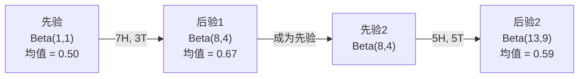

# 贝叶斯定理

> 概率关注的是你预期什么。贝叶斯定理关注的是你学到什么。

**类型：** 构建
**语言：** Python
**先修知识：** 第1阶段，第06课（概率基础）
**时间：** 约75分钟

## 学习目标

- 应用贝叶斯定理，从先验概率、似然度和证据计算后验概率
- 使用拉普拉斯平滑和对数空间计算从零构建朴素贝叶斯文本分类器
- 比较MLE和MAP估计，并解释MAP如何对应L2正则化
- 使用Beta-Binomial共轭先验实现序贯贝叶斯更新，用于A/B测试

## 问题

一项医学检测准确率为99%。你检测结果为阳性。你实际患病的概率是多少？

大多数人会说是99%。真正的答案取决于这种疾病的罕见程度。如果1万人中才有1人患病，阳性结果只意味着你大约只有1%的概率患病。其他99%的阳性结果都是健康人的假警报。

这不是一个陷阱问题。这就是贝叶斯定理。每一个垃圾邮件过滤器、每一次医学诊断、每一个量化不确定性的机器学习模型，都使用完全相同的推理方式。你从一种信念开始。你看到了证据。你更新了它。

如果你不理解这一点就构建机器学习系统，你会误解模型输出、设置糟糕的阈值，并发布过度自信的预测。

## 概念

### 从联合概率到贝叶斯

你从第06课已经知道条件概率是：

```
P(A|B) = P(A and B) / P(B)
```

对称地：

```
P(B|A) = P(A and B) / P(A)
```

两个表达式共享同一个分子：P(A and B)。将它们等同并重新排列：

```
P(A and B) = P(A|B) * P(B) = P(B|A) * P(A)

因此：

P(A|B) = P(B|A) * P(A) / P(B)
```

这就是贝叶斯定理。四个量，一个方程。

### 四个部分

| 部分 | 名称 | 含义 |
|------|------|------|
| P(A\|B) | 后验概率 | 看到证据B后你对A的更新信念 |
| P(B\|A) | 似然度 | 如果A为真，证据B出现的概率 |
| P(A) | 先验概率 | 看到任何证据之前你对A的信念 |
| P(B) | 证据 | 在所有可能性下看到B的总概率 |

证据项P(B)充当归一化器。你可以使用全概率定律展开它：

```
P(B) = P(B|A) * P(A) + P(B|not A) * P(not A)
```

### 医学检测示例

一种疾病影响1万人中有1人。检测准确率为99%（能捕获99%的患病者，对健康人有1%的假阳性率）。

```
P(sick)          = 0.0001     (先验概率：疾病罕见)
P(positive|sick) = 0.99       (似然度：检测能发现它)
P(positive|healthy) = 0.01    (假阳性率)

P(positive) = P(positive|sick) * P(sick) + P(positive|healthy) * P(healthy)
            = 0.99 * 0.0001 + 0.01 * 0.9999
            = 0.000099 + 0.009999
            = 0.010098

P(sick|positive) = P(positive|sick) * P(sick) / P(positive)
                 = 0.99 * 0.0001 / 0.010098
                 = 0.0098
                 = 0.98%
```

不到1%。先验概率占据主导地位。当某种疾病罕见时，即使是准确的检测也会产生大多是假阳性。这就是为什么医生会要求进行确认检测。

### 垃圾邮件过滤器示例

你收到一封包含单词"lottery"的电子邮件。它是垃圾邮件吗？

```
P(spam)                = 0.3      (30%的邮件是垃圾邮件)
P("lottery"|spam)      = 0.05     (5%的垃圾邮件包含"lottery")
P("lottery"|not spam)  = 0.001    (0.1%的合法邮件包含"lottery")

P("lottery") = 0.05 * 0.3 + 0.001 * 0.7
             = 0.015 + 0.0007
             = 0.0157

P(spam|"lottery") = 0.05 * 0.3 / 0.0157
                   = 0.955
                   = 95.5%
```

一个词就将概率从30%提升到了95.5%。真正的垃圾邮件过滤器同时在数百个词上应用贝叶斯定理。

### 朴素贝叶斯：独立性假设

朴素贝叶斯通过假设所有特征在给定类别下是条件独立的，将这种方法扩展到多个特征：

```
P(class | feature_1, feature_2, ..., feature_n)
  = P(class) * P(feature_1|class) * P(feature_2|class) * ... * P(feature_n|class)
    / P(feature_1, feature_2, ..., feature_n)
```

"朴素"的部分是独立性假设。在文本中，词的出现不是独立的（"New"和"York"是相关的）。但这个假设在实践中出奇地有效，因为分类器只需要对类别进行排序，而不需要产生校准好的概率。

由于分母对所有类别都是相同的，你可以跳过它，只比较分子：

```
score(class) = P(class) * P(feature_i | class)的乘积
```

选择得分最高的类别。

### 最大似然估计（MLE）

你如何从训练数据中获得P(feature|class)？统计。

```
P("free"|spam) = (包含"free"的垃圾邮件数量) / (垃圾邮件总数)
```

这就是MLE：选择使观测数据最可能的参数值。你正在最大化似然函数，对于离散计数来说，它简化为相对频率。

问题：如果一个词在训练期间从未出现在垃圾邮件中，MLE会赋予它零概率。一个未见过的词会杀死整个乘积。使用拉普拉斯平滑修复：

```
P(word|class) = (count(word, class) + 1) / (total_words_in_class + vocabulary_size)
```

给每个计数加1确保任何概率永远不会为零。

### 最大后验概率（MAP）

MLE问：什么参数使P(data|parameters)最大化？

MAP问：什么参数使P(parameters|data)最大化？

根据贝叶斯定理：

```
P(parameters|data) 与 P(data|parameters) * P(parameters) 成正比
```

MAP在参数本身之上增加了先验。如果你认为参数应该很小，你将这种信念编码为惩罚大值的先验。这等同于机器学习中的L2正则化。岭回归中的"ridge"惩罚字面上就是权重上的高斯先验。

| 估计方法 | 优化 | ML等价 |
|------------|-----------|---------------|
| MLE | P(data\|params) | 无正则化训练 |
| MAP | P(data\|params) * P(params) | L2 / L1正则化 |

### 贝叶斯 vs 频率主义：实际差异

频率主义者将参数视为固定的未知量。他们问："如果我多次重复这个实验，会发生什么？"

贝叶斯主义者将参数视为分布。他们问："根据我观察到的东西，我对参数的信念是什么？"

对于构建机器学习系统，实际差异：

| 方面 | 频率主义 | 贝叶斯 |
|--------|-------------|----------|
| 输出 | 点估计 | 值的分布 |
| 不确定性 | 置信区间（关于过程） | 可信区间（关于参数） |
| 小数据 | 可能过拟合 | 先验充当正则化 |
| 计算 | 通常更快 | 通常需要采样（MCMC） |

大多数生产中的机器学习是频率主义的（SGD，点估计）。当你需要校准的不确定性（医学决策，安全关键系统）或当数据稀缺时（少样本学习，冷启动），贝叶斯方法会大放异彩。

### 为什么贝叶斯思维对机器学习很重要

这种联系不仅仅是类比：

**先验是正则化。** 权重上的高斯先验是L2正则化。拉普拉斯先验是L1。每次你添加正则化项时，你都在做一个贝叶斯陈述，关于你期望什么参数值。

**后验是不确定性。** 单一的预测概率告诉你关于该估计的置信度为零。贝叶斯方法给你一个分布："我认为P(spam)在0.8和0.95之间。"

**贝叶斯更新是在线学习。** 今天的后验成为明天的先验。当你的模型看到新数据时，它增量式地更新其信念，而不是从头重新训练。

**模型比较是贝叶斯的。** 贝叶斯信息准则（BIC）、边缘似然和贝叶斯因子都使用贝叶斯推理在不发生过拟合的情况下选择模型。

```figure
bayes-update
```

## 构建它

### 步骤1：贝叶斯定理函数

```python
def bayes(prior, likelihood, false_positive_rate):
    evidence = likelihood * prior + false_positive_rate * (1 - prior)
    posterior = likelihood * prior / evidence
    return posterior

result = bayes(prior=0.0001, likelihood=0.99, false_positive_rate=0.01)
print(f"P(sick|positive) = {result:.4f}")
```

### 步骤2：朴素贝叶斯分类器

```python
import math
from collections import defaultdict

class NaiveBayes:
    def __init__(self, smoothing=1.0):
        self.smoothing = smoothing
        self.class_counts = defaultdict(int)
        self.word_counts = defaultdict(lambda: defaultdict(int))
        self.class_word_totals = defaultdict(int)
        self.vocab = set()

    def train(self, documents, labels):
        for doc, label in zip(documents, labels):
            self.class_counts[label] += 1
            words = doc.lower().split()
            for word in words:
                self.word_counts[label][word] += 1
                self.class_word_totals[label] += 1
                self.vocab.add(word)

    def predict(self, document):
        words = document.lower().split()
        total_docs = sum(self.class_counts.values())
        vocab_size = len(self.vocab)
        best_class = None
        best_score = float("-inf")
        for cls in self.class_counts:
            score = math.log(self.class_counts[cls] / total_docs)
            for word in words:
                count = self.word_counts[cls].get(word, 0)
                total = self.class_word_totals[cls]
                score += math.log((count + self.smoothing) / (total + self.smoothing * vocab_size))
            if score > best_score:
                best_score = score
                best_class = cls
        return best_class
```

对数概率可以防止下溢。将许多小概率相乘会产生太小而无法用浮点数表示的数字。对对数概率求和在数值上是稳定的，并且在数学上是等价的。

### 步骤3：在垃圾邮件数据上训练

```python
train_docs = [
    "win free money now",
    "free lottery ticket winner",
    "claim your prize today free",
    "urgent offer free cash",
    "congratulations you won free",
    "meeting tomorrow at noon",
    "project update attached",
    "can we schedule a call",
    "quarterly report review",
    "lunch on thursday sounds good",
    "team standup notes attached",
    "please review the pull request",
]

train_labels = [
    "spam", "spam", "spam", "spam", "spam",
    "ham", "ham", "ham", "ham", "ham", "ham", "ham",
]

classifier = NaiveBayes()
classifier.train(train_docs, train_labels)

test_messages = [
    "free money waiting for you",
    "meeting rescheduled to friday",
    "you won a free prize",
    "please review the attached report",
]

for msg in test_messages:
    print(f"  '{msg}' -> {classifier.predict(msg)}")
```

### 步骤4：检查学习到的概率

```python
def show_top_words(classifier, cls, n=5):
    vocab_size = len(classifier.vocab)
    total = classifier.class_word_totals[cls]
    probs = {}
    for word in classifier.vocab:
        count = classifier.word_counts[cls].get(word, 0)
        probs[word] = (count + classifier.smoothing) / (total + classifier.smoothing * vocab_size)
    sorted_words = sorted(probs.items(), key=lambda x: x[1], reverse=True)
    for word, prob in sorted_words[:n]:
        print(f"    {word}: {prob:.4f}")

print("\nTop spam words:")
show_top_words(classifier, "spam")
print("\nTop ham words:")
show_top_words(classifier, "ham")
```

## 使用它

scikit-learn 提供了生产就绪的朴素贝叶斯实现：

```python
from sklearn.feature_extraction.text import CountVectorizer
from sklearn.naive_bayes import MultinomialNB
from sklearn.metrics import classification_report

vectorizer = CountVectorizer()
X_train = vectorizer.fit_transform(train_docs)
clf = MultinomialNB()
clf.fit(X_train, train_labels)

X_test = vectorizer.transform(test_messages)
predictions = clf.predict(X_test)
for msg, pred in zip(test_messages, predictions):
    print(f"  '{msg}' -> {pred}")
```

相同的算法。CountVectorizer 处理分词和词汇表构建。MultinomialNB 在内部处理平滑和对数概率。你的从零开始的版本在40行代码中做了同样的事情。

## 部署它

这里构建的 NaiveBayes 类演示了完整的流程：分词、使用拉普拉斯平滑的概率估计、对数空间预测。`code/bayes.py` 中的代码端到端运行，除了 Python 标准库之外没有其他依赖。

### 共轭先验

当先验和后验属于同一分布族时，先验被称为"共轭的"。这使得贝叶斯更新在代数上是简洁的——你得到了一个闭式后验，无需数值积分。

| 似然度 | 共轭先验 | 后验 | 示例 |
|-----------|----------------|-----------|---------|
| 伯努利 | Beta(a, b) | Beta(a + 成功次数, b + 失败次数) | 硬币翻转偏差估计 |
| 正态分布（已知方差） | Normal(mu_0, sigma_0) | Normal(加权均值，更小方差) | 传感器校准 |
| 泊松 | Gamma(a, b) | Gamma(a + 计数总和, b + n) | 建模到达率 |
| 多项分布 | Dirichlet(alpha) | Dirichlet(alpha + 计数) | 主题建模，语言模型 |

为什么这很重要：没有共轭先验，你需要蒙特卡洛采样或变分推断来近似后验。使用共轭先验，你只需更新两个数字。

Beta 分布是实践中最常见的共轭先验。Beta(a, b) 表示你对一个概率参数的信念。均值是 a/(a+b)。a+b 越大，分布越集中（越有信心）。

Beta 先验的特殊情况：
- Beta(1, 1) = 均匀分布。你对这个参数没有意见。
- Beta(10, 10) = 在0.5处达到峰值。你强烈相信这个参数接近0.5。
- Beta(1, 10) = 偏向0。你认为这个参数很小。

更新规则非常简单：

```
先验：     Beta(a, b)
数据：      s次成功，f次失败
后验：     Beta(a + s, b + f)
```

不需要积分。不需要采样。只需要加法。

### 序贯贝叶斯更新

贝叶斯推理本质上是序贯的。今天的后验成为明天的先验。这就是真实系统如何增量学习而不需要重新处理所有历史数据。

具体例子：估计一枚硬币是否公平。

**第1天：还没有数据。**
从 Beta(1, 1) 开始——均匀先验。你对这个参数没有意见。
- 先验均值：0.5
- 先验在 [0, 1] 上是平坦的

**第2天：观察到7个正面，3个反面。**
后验 = Beta(1 + 7, 1 + 3) = Beta(8, 4)
- 后验均值：8/12 = 0.667
- 证据表明硬币偏向正面

**第3天：再观察到5个正面，5个反面。**
使用昨天的后验作为今天的先验。
后验 = Beta(8 + 5, 4 + 5) = Beta(13, 9)
- 后验均值：13/22 = 0.591
- 平衡的新数据将估计拉回向0.5



观察的顺序并不重要。Beta(1,1) 一次性更新所有12个正面和8个反面得到 Beta(13, 9)——相同的结果。序贯更新和批量更新在数学上是等价的。但序贯更新让你可以在每一步做出决策，而无需存储原始数据。

这是生产机器学习系统中在线学习的基础。汤普森采样用于多臂老虎机、增量推荐系统和流式异常检测都使用这种模式。

### 与A/B测试的联系

A/B测试是伪装的贝叶斯推理。

设置：你正在测试两个按钮颜色。变体A（蓝色）和变体B（绿色）。你想知道哪个获得更多点击。

贝叶斯A/B测试：

1. **先验。** 两个变体都从 Beta(1, 1) 开始。没有先验偏好。
2. **数据。** 变体A：1000次浏览中有50次点击。变体B：1000次浏览中有65次点击。
3. **后验。**
   - A：Beta(1 + 50, 1 + 950) = Beta(51, 951)。均值 = 0.051
   - B：Beta(1 + 65, 1 + 935) = Beta(66, 936)。均值 = 0.066
4. **决策。** 计算 P(B > A) —— B的真实转化率高于A的概率。

分析计算 P(B > A) 很难。但蒙特卡洛使其变得简单：

```
1. 从 Beta(51, 951) 中抽取100,000个样本  -> samples_A
2. 从 Beta(66, 936) 中抽取100,000个样本  -> samples_B
3. P(B > A) = B > A 的样本比例
```

如果 P(B > A) > 0.95，你发布变体B。如果在0.05和0.95之间，你继续收集数据。如果 P(B > A) < 0.05，你发布变体A。

相对于频率主义A/B测试的优势：
- 你得到一个直接的概率陈述："有97%的可能性B更好"
- 没有p值混淆。没有"未能拒绝零假设"的支吾其词。
- 你可以在任何时间检查结果，而不会增加假阳性率（没有"偷看问题"）
- 你可以结合先验知识（例如，之前的测试表明转化率通常在3-8%）

| 方面 | 频率主义A/B测试 | 贝叶斯A/B测试 |
|--------|----------------|--------------|
| 输出 | p值 | P(B > A) |
| 解释 | "如果A=B，这个数据有多令人惊讶？" | "B优于A的可能性有多大？" |
| 提前停止 | 增加假阳性 | 在任何时候都是安全的（给定精心选择的先验和正确指定的模型） |
| 先验知识 | 不使用 | 编码为Beta先验 |
| 决策规则 | p < 0.05 | P(B > A) > 阈值 |

## 练习

1. **多次测试。** 一名患者在两次独立的检测中都呈阳性（都99%准确，疾病患病率1/10,000）。两次检测后 P(sick) 是多少？使用第一次检测的后验作为第二次检测的先验。

2. **平滑影响。** 以0.01、0.1、1.0和10.0的平滑值运行垃圾邮件分类器。顶级词概率如何变化？当平滑=0且一个词只出现在ham中时会发生什么？

3. **添加特征。** 扩展 NaiveBayes 类，以使用消息长度（短/长）作为与词计数一起的特征。从训练数据中估计 P(short|spam) 和 P(short|ham)，并将其合并到预测得分中。

4. **手工计算MAP。** 给定观测数据（10次硬币翻转中有7次正面），使用 Beta(2,2) 先验计算偏差的MAP估计。将其与MLE估计（7/10）进行比较。

## 关键术语

| 术语 | 人们怎么说 | 它实际意味着什么 |
|------|----------------|----------------------|
| 先验概率 | "我最初的猜测" | 观察证据之前的 P(hypothesis)。在ML中：正则化项。 |
| 似然度 | "数据拟合得有多好" | P(evidence\|hypothesis)。在特定假设下观测数据出现的概率。 |
| 后验概率 | "我更新后的信念" | P(hypothesis\|evidence)。先验乘以似然度，然后归一化。 |
| 证据 | "归一化常数" | 所有假设下的 P(data)。确保后验总和为1。 |
| 朴素贝叶斯 | "那个简单的文本分类器" | 一个假设给定类别下特征独立的分类器。尽管这个假设是错误的，但效果很好。 |
| 拉普拉斯平滑 | "加一平滑" | 给每个特征添加一个小计数，以防止从未见数据的零概率。 |
| MLE | "直接使用频率" | 选择使 P(data\|parameters) 最大化的参数。没有先验。小数据可能过拟合。 |
| MAP | "带有先验的MLE" | 选择使 P(data\|parameters) * P(parameters) 最大化的参数。等价于正则化MLE。 |
| 对数概率 | "在对数空间工作" | 使用 log(P) 而不是 P，以避免在相乘许多小数时出现浮点下溢。 |
| 假阳性 | "错误的警报" | 检测说阳性，但真实状态是阴性。驱动基础比率谬误。 |

## 延伸阅读

- [3Blue1Brown：贝叶斯定理](https://www.youtube.com/watch?v=HZGCoVF3YvM) - 使用医学检测示例进行可视化解释
- [Stanford CS229：生成学习算法](https://cs229.stanford.edu/notes2022fall/cs229-notes2.pdf) - 朴素贝叶斯及其与判别模型的关系
- [Think Bayes](https://greenteapress.com/wp/think-bayes/) - 免费书籍，使用Python代码进行贝叶斯统计
- [scikit-learn 朴素贝叶斯](https://scikit-learn.org/stable/modules/naive_bayes.html) - 生产实现以及何时使用每个变体
