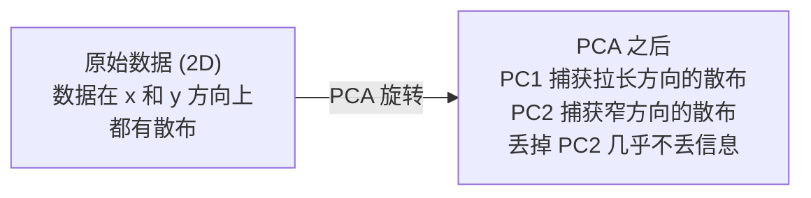

# 降维

> 高维数据是有结构的。只要从正确的角度去看，你就能找到它。

**类型：** 构建
**语言：** Python
**先修知识：** 第1阶段，第01课（线性代数直觉）、第02课（向量、矩阵与运算）、第03课（特征值与特征向量）、第06课（概率与分布）
**时间：** 约90分钟

## 学习目标

- 从零实现 PCA：数据中心化、计算协方差矩阵、特征分解、投影
- 使用解释方差比和肘部法则选择主成分的数量
- 比较 PCA、t-SNE 和 UMAP 在把 MNIST 手写数字可视化到 2D 时的效果，并说明它们的取舍
- 应用 RBF 核的核 PCA，分离标准 PCA 无法处理的非线性数据结构

## 问题

你有一个数据集，每个样本有 784 个特征。也许是手写数字的像素值。也许是基因表达水平。也许是用户行为信号。你无法可视化 784 维。你画不出图。你甚至无法去思考它。

但其中大多数特征都是冗余的。真正有用的信息其实活在某个小得多的"表面"上。一个手写数字 "7" 并不需要 784 个独立的数字来描述它。它只需要几个：笔画的角度、横杠的长度、向哪边倾斜。其余的都是噪声。

降维就是找到那个更小的表面。它把你的 784 维数据压缩到 2 维、10 维或 50 维，同时保留真正重要的结构。

> 注：想象你有一张高分辨率照片，但真正有用的只有"这是猫"这个结论。降维就是从海量像素中提炼出最有用的几个数字。

## 概念

### 维度诅咒

高维空间反直觉。随着维度增长，有三件事会"坏掉"。

**距离变得没意义。** 在高维空间里，任意两个随机点之间的距离会收敛到几乎相同的值。如果每个点到其他所有点的距离都差不多，最近邻搜索就失效了。

```
维度    随机点间距离比值（最远/最近）
2       ~5.0
10      ~1.8
100     ~1.2
1000    ~1.02
```

> 注：在 2 维里，最近的点和最远的点距离能差 5 倍；到了 1000 维， everywhere 都差不多远。"最近邻"这个概念就崩塌了。

**体积集中在角落。** d 维的单位超立方体有 2^d 个角。在 100 维里，几乎全部体积都在角落里，远离中心。数据点会散布到边缘，模型在内部得不到数据。

**你需要指数级更多的数据。** 为了在空间里维持同样的样本密度，从 2D 到 20D，你需要 10^18 倍的数据。你永远没有那么多。降维把数据密度拉回到可工作的范围。

### PCA：找到真正重要的方向

主成分分析（PCA）找到数据变化最大的坐标轴。它旋转坐标系，使第一轴捕获最多方差，第二轴捕获次多，依此类推。

算法流程：

```
1. 中心化数据       （每个特征减去均值）
2. 计算协方差       （特征之间如何共同变化）
3. 特征分解         （找到主方向）
4. 按特征值排序     （方差最大的在前）
5. 投影             （保留前 k 个特征向量，丢掉其余）
```

为什么用特征分解？协方差矩阵是对称且半正定的。它的特征向量是特征空间里互相正交的方向。特征值告诉你每个方向捕获了多少方差。特征值最大的那个特征向量，就指向方差最大的方向。



- **PCA 之前：** 数据云沿 x 和 y 两个轴斜向散布
- **PCA 之后：** 坐标系被旋转，PC1 对齐方差最大的方向（拉长方向），PC2 对齐方差最小的方向（窄方向）
- **降维：** 丢掉 PC2，把数据投影到 PC1 上，几乎不丢失信息

> 注：把"斜着长的一团点"旋转成"横着长的一团点"，横轴就是 PC1，竖轴就是 PC2。竖轴方向变化很小，所以可以放心丢掉。

### 解释方差比

每个主成分都捕获了总方差的一部分。解释方差比告诉你捕获了多少。

```
成分    特征值    解释比例    累计
PC1     4.73      0.473       0.473
PC2     2.51      0.251       0.724
PC3     1.12      0.112       0.836
PC4     0.89      0.089       0.925
...
```

当累计解释方差达到 0.95 时，你知道这么多主成分保留了 95% 的信息。之后的成分大多是噪声。

### 选择主成分的数量

三种策略：

1. **阈值法。** 保留足够多的成分，使解释方差达到 90-95%。
2. **肘部法则。** 画出每个成分的解释方差，寻找急剧下降的"拐点"。
3. **下游性能。** 把 PCA 作为预处理，扫描 k 值并测量模型准确率。准确率平台期所在的位置就是最好的 k。

### t-SNE：保留邻域

t 分布随机邻域嵌入（t-SNE）是为可视化设计的。它把高维数据映射到 2D（或 3D），同时保留哪些点彼此相邻。

直觉：在原始空间里，根据点之间的距离计算成对概率分布。近的点概率高，远的点概率低。然后找到一个 2D 排列，使得同样的概率分布成立。在 784 维里是邻居的点，在 2D 里仍然是邻居。

t-SNE 的关键性质：

- 非线性。它能展开 PCA 无法展开的复杂流形。
- 随机性。每次运行都会产生不同的布局。
- Perplexity 参数控制考虑多少邻居（典型范围：5-50）。
- 输出里簇之间的距离没有意义。只有簇本身是有意义的。
- 对大数据集慢。默认是 O(n^2)。

> 注：t-SNE 的图"好看"但不能当尺子用。两个簇画得远，不代表它们在原空间里就真的远。

### UMAP：更快，全局结构更好

均匀流形近似与投影（UMAP）与 t-SNE 类似，但有两个优势：

- 更快。使用近似最近邻图，而不是计算所有点对之间的距离。
- 全局结构更好。输出里簇之间的相对位置，比 t-SNE 更有意义。

UMAP 先在高维空间构建一个加权图（"模糊拓扑表示"），然后找到一个低维布局，尽可能保留这个图。

关键参数：

- `n_neighbors`：多少邻居定义局部结构（类似 perplexity）。越大保留的全局结构越多。
- `min_dist`：输出里点聚得有多紧。越小簇越密集。

### 什么时候用哪一种

| 方法 | 使用场景 | 保留的内容 | 速度 |
|------|----------|-----------|------|
| PCA | 训练前的预处理 | 全局方差 | 快（精确），可处理百万级样本 |
| PCA | 快速探索性可视化 | 线性结构 | 快 |
| t-SNE | 发表级 2D 图 | 局部邻域 | 慢（理想规模 < 1 万样本） |
| UMAP | 大规模 2D 可视化 | 局部 + 部分全局结构 | 中等（可处理百万级） |
| PCA | 给模型做特征降维 | 按方差排序的特征 | 快 |
| t-SNE / UMAP | 理解簇结构 | 簇的分离 | 中等到慢 |

经验法则：用 PCA 做预处理和数据压缩。需要在 2D 看结构时用 t-SNE 或 UMAP。

### 核 PCA

标准 PCA 找的是线性子空间。它旋转坐标系然后丢轴。但如果数据躺在非线性流形上呢？2D 里的同心圆无法被任何直线分开。标准 PCA 无能为力。

核 PCA 在由核函数诱导的高维特征空间里做 PCA，而不需要显式计算该空间的坐标。这就是核技巧——和 SVM 背后的思想相同。

算法流程：

1. 计算核矩阵 K，其中 K_ij = k(x_i, x_j)
2. 在特征空间里中心化核矩阵
3. 对中心化后的核矩阵做特征分解
4. 前几大特征向量（乘以 1/sqrt(特征值)）就是投影

常用核函数：

| 核 | 公式 | 适用场景 |
|----|------|----------|
| RBF（高斯） | exp(-gamma * \|\|x - y\|\|^2) | 大多数非线性数据、平滑流形 |
| 多项式 | (x . y + c)^d | 多项式关系 |
| Sigmoid | tanh(alpha * x . y + c) | 类神经网络映射 |

核 PCA vs 标准 PCA 的选择：

| 标准 | 标准 PCA | 核 PCA |
|------|----------|--------|
| 数据结构 | 线性子空间 | 非线性流形 |
| 速度 | O(min(n^2 d, d^2 n)) | O(n^2 d + n^3) |
| 可解释性 | 成分是特征的线性组合 | 成分没有直接的特征解释 |
| 可扩展性 | 可处理百万级样本 | 核矩阵是 n x n，受内存限制 |
| 重建 | 直接逆变换 | 需要预像近似 |

经典例子：2D 里的同心圆。两圈点，一圈在另一圈里面。标准 PCA 把两圈都投影到同一条直线上——对分类毫无用处。核 PCA 配合 RBF 核把内圈和外圈映射到不同区域，使它们线性可分。

> 注：核 PCA 的代价是内存。核矩阵是 n x n，1 万个样本就要 800MB（float64），所以它不适合超大数据集。

### 重建误差

你的降维有多好？你把 784 维压到了 50 维。你丢了什么？

衡量重建误差：

1. 投影到 k 维：X_reduced = X @ W_k
2. 重建：X_hat = X_reduced @ W_k^T
3. 计算 MSE：mean((X - X_hat)^2)

对于 PCA，重建误差和解释方差有干净的关系：

```
重建误差 = 未被包含的特征值之和
总方差   = 全部特征值之和
丢失比例 = （被丢弃的特征值之和）/（全部特征值之和）
```

每个成分的解释方差比是：

```
explained_ratio_k = eigenvalue_k / sum(all eigenvalues)
```

画出累计解释方差随成分数量变化的曲线，就得到"肘部"曲线。合适的成分数是曲线在以下位置：

- 曲线变平（收益递减）
- 累计方差越过阈值（通常 0.90 或 0.95）
- 下游任务性能达到平台期

重建误差的用途不止选 k。你还可以用它做异常检测：重建误差高的样本就是离群点，它们不属于学到的子空间。这是生产系统中基于 PCA 的异常检测的基础。

```figure
pca-axes
```

## 构建它

### 步骤1：从零实现 PCA

```python
import numpy as np

class PCA:
    def __init__(self, n_components):
        self.n_components = n_components
        self.components = None
        self.mean = None
        self.eigenvalues = None
        self.explained_variance_ratio_ = None

    def fit(self, X):
        self.mean = np.mean(X, axis=0)
        X_centered = X - self.mean

        cov_matrix = np.cov(X_centered, rowvar=False)

        eigenvalues, eigenvectors = np.linalg.eigh(cov_matrix)

        sorted_idx = np.argsort(eigenvalues)[::-1]
        eigenvalues = eigenvalues[sorted_idx]
        eigenvectors = eigenvectors[:, sorted_idx]

        self.components = eigenvectors[:, :self.n_components].T
        self.eigenvalues = eigenvalues[:self.n_components]
        total_var = np.sum(eigenvalues)
        self.explained_variance_ratio_ = self.eigenvalues / total_var

        return self

    def transform(self, X):
        X_centered = X - self.mean
        return X_centered @ self.components.T

    def fit_transform(self, X):
        self.fit(X)
        return self.transform(X)
```

> 注：`np.linalg.eigh` 专门用于对称矩阵，比通用的 `eig` 更稳定更快。协方差矩阵是对称的，所以用它。

### 步骤2：在合成数据上测试

```python
np.random.seed(42)
n_samples = 500

t = np.random.uniform(0, 2 * np.pi, n_samples)
x1 = 3 * np.cos(t) + np.random.normal(0, 0.2, n_samples)
x2 = 3 * np.sin(t) + np.random.normal(0, 0.2, n_samples)
x3 = 0.5 * x1 + 0.3 * x2 + np.random.normal(0, 0.1, n_samples)

X_synthetic = np.column_stack([x1, x2, x3])

pca = PCA(n_components=2)
X_reduced = pca.fit_transform(X_synthetic)

print(f"Original shape: {X_synthetic.shape}")
print(f"Reduced shape:  {X_reduced.shape}")
print(f"Explained variance ratios: {pca.explained_variance_ratio_}")
print(f"Total variance captured: {sum(pca.explained_variance_ratio_):.4f}")
```

### 步骤3：MNIST 数字降到 2D

```python
from sklearn.datasets import fetch_openml

mnist = fetch_openml("mnist_784", version=1, as_frame=False, parser="auto")
X_mnist = mnist.data[:5000].astype(float)
y_mnist = mnist.target[:5000].astype(int)

pca_mnist = PCA(n_components=50)
X_pca50 = pca_mnist.fit_transform(X_mnist)
print(f"50 components capture {sum(pca_mnist.explained_variance_ratio_):.2%} of variance")

pca_2d = PCA(n_components=2)
X_pca2d = pca_2d.fit_transform(X_mnist)
print(f"2 components capture {sum(pca_2d.explained_variance_ratio_):.2%} of variance")
```

### 步骤4：与 sklearn 对比

```python
from sklearn.decomposition import PCA as SklearnPCA
from sklearn.manifold import TSNE

sklearn_pca = SklearnPCA(n_components=2)
X_sklearn_pca = sklearn_pca.fit_transform(X_mnist)

print(f"\nOur PCA explained variance:     {pca_2d.explained_variance_ratio_}")
print(f"Sklearn PCA explained variance: {sklearn_pca.explained_variance_ratio_}")

diff = np.abs(np.abs(X_pca2d) - np.abs(X_sklearn_pca))
print(f"Max absolute difference: {diff.max():.10f}")

tsne = TSNE(n_components=2, perplexity=30, random_state=42)
X_tsne = tsne.fit_transform(X_mnist)
print(f"\nt-SNE output shape: {X_tsne.shape}")
```

### 步骤5：UMAP 对比

```python
try:
    from umap import UMAP

    reducer = UMAP(n_components=2, n_neighbors=15, min_dist=0.1, random_state=42)
    X_umap = reducer.fit_transform(X_mnist)
    print(f"UMAP output shape: {X_umap.shape}")
except ImportError:
    print("Install umap-learn: pip install umap-learn")
```

## 使用它

PCA 作为分类器前的预处理：

```python
from sklearn.decomposition import PCA as SklearnPCA
from sklearn.linear_model import LogisticRegression
from sklearn.model_selection import train_test_split
from sklearn.metrics import accuracy_score

X_train, X_test, y_train, y_test = train_test_split(
    X_mnist, y_mnist, test_size=0.2, random_state=42
)

results = {}
for k in [10, 30, 50, 100, 200]:
    pca_k = SklearnPCA(n_components=k)
    X_tr = pca_k.fit_transform(X_train)
    X_te = pca_k.transform(X_test)

    clf = LogisticRegression(max_iter=1000, random_state=42)
    clf.fit(X_tr, y_train)
    acc = accuracy_score(y_test, clf.predict(X_te))
    var_captured = sum(pca_k.explained_variance_ratio_)
    results[k] = (acc, var_captured)
    print(f"k={k:>3d}  accuracy={acc:.4f}  variance={var_captured:.4f}")
```

性能在远未达到 784 维之前就达到平台期。那个平台期就是你的工作点。

> 注：PCA 降维还能加速训练、减少内存，且常常还能提高泛化（去噪）。但 k 太小会丢信息，k 太大又失去降维的意义。

## 部署它

本课产出：

- `outputs/skill-dimensionality-reduction.md` - 为给定任务选择合适降维技术的技能

## 练习

1. 修改 PCA 类，支持 `inverse_transform`。从 10、50 和 200 个成分重建 MNIST 数字。打印每个的重建误差（与原始的均方差）。

2. 对同样的 MNIST 子集运行 t-SNE，perplexity 分别取 5、30、100。描述输出如何变化。为什么 perplexity 会影响簇的紧凑程度？

3. 取一个有 50 个特征但只有 5 个信息特征的数据集（用 `sklearn.datasets.make_classification` 生成）。应用 PCA，检查解释方差曲线是否正确识别出数据实际上只有 5 维。

## 关键术语

| 术语 | 人们怎么说 | 它实际意味着什么 |
|------|------------|------------------|
| 维度诅咒 | "特征太多" | 随着维度增长，距离、体积和数据密度都表现反直觉。模型需要指数级更多数据来补偿。 |
| PCA | "降维" | 旋转坐标系，使坐标轴对齐方差最大的方向，然后丢掉低方差的轴。 |
| 主成分 | "一个重要方向" | 协方差矩阵的特征向量。特征空间里数据变化最大的方向。 |
| 解释方差比 | "这个成分有多少信息" | 一个主成分捕获的总方差比例。把前 k 个比例相加，就能看出 k 个成分保留了多少。 |
| 协方差矩阵 | "特征如何相关" | 对称矩阵，第 (i,j) 项衡量特征 i 和特征 j 如何共同变化。对角线元素是各自方差。 |
| t-SNE | "那个簇图" | 通过保留成对邻域概率，把高维数据映射到 2D 的非线性方法。适合可视化，不适合预处理。 |
| UMAP | "更快的 t-SNE" | 基于拓扑数据分析的非线性方法。同时保留局部和部分全局结构。扩展性比 t-SNE 更好。 |
| Perplexity | "t-SNE 的旋钮" | 控制每个点考虑的有效邻居数。低 perplexity 聚焦极局部结构。高 perplexity 捕获更广的模式。 |
| 流形 | "数据所在的表面" | 嵌入在高维空间里的低维表面。一张在 3D 里被揉皱的纸就是 2D 流形。 |

## 延伸阅读

- [A Tutorial on Principal Component Analysis](https://arxiv.org/abs/1404.1100) (Shlens) - 从零清晰推导 PCA
- [How to Use t-SNE Effectively](https://distill.pub/2016/misread-tsne/) (Wattenberg et al.) - t-SNE 的陷阱和参数选择交互式指南
- [UMAP documentation](https://umap-learn.readthedocs.io/) - UMAP 作者提供的理论和实践指南
