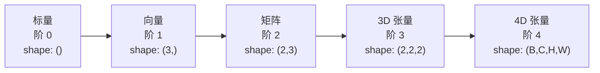
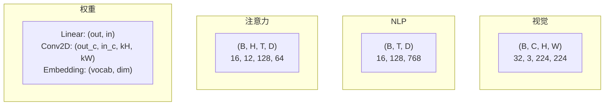
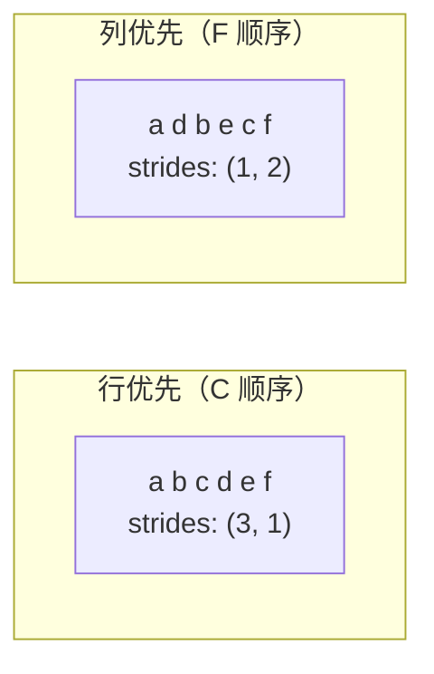
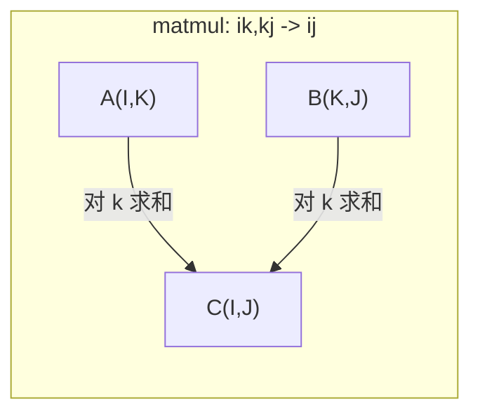

# 张量运算

> 张量是数据与深度学习之间的通用语言。每一张图像、每一段句子、每一个梯度，都流经它。

**类型：** 构建
**语言：** Python
**先修知识：** 第1阶段，第01课（线性代数直觉）、第02课（向量、矩阵与运算）
**时间：** 约90分钟

## 学习目标

- 从零实现一个张量类：包含形状、步幅、重塑、转置和逐元素运算
- 应用广播规则，在不复制数据的情况下对不同形状的张量进行运算
- 为点积、矩阵乘法、外积和批量运算编写 einsum 表达式
- 追踪多头注意力中每一步的精确张量形状

## 问题

你构建了一个 Transformer。前向传播看起来很干净。你运行它，得到：`RuntimeError: mat1 and mat2 shapes cannot be multiplied (32x768 and 512x768)`。你盯着这些形状。你试了一次转置。现在它说 `Expected 4D input (got 3D input)`。你加了一个 unsqueeze。别的地方又坏了。

形状错误是深度学习代码中最常见的 Bug。它们在概念上并不难——每个操作都有一个形状契约——但它们会快速累积。一个 Transformer 有几十个 reshape、transpose 和 broadcast 链在一起。一个轴写错，错误就会级联。更糟的是，有些形状错误根本不会抛异常。它们会通过在错误的维度上广播或对错误的轴求和，悄悄产出垃圾结果。

矩阵处理的是两组事物之间的成对关系。真实数据并不适合用二维来装。一批 32 张 224x224 的 RGB 图像是一个 4D 张量：`(32, 3, 224, 224)`。带 12 个头的自注意力也是 4D：`(batch, heads, seq_len, head_dim)`。你需要一种能推广到任意维度的数据结构，且操作能在所有维度上干净地组合。这个结构就是张量。掌握它的运算，形状错误就变得 trivially 可调试。

> 注：形状错误之所以"静默"危险，是因为广播规则太宽容——它会自动扩展维度，而你可能根本没意识到扩展发生在了错误的轴上。调试时先打印每一步的 `.shape`，永远比猜更可靠。

## 概念

### 张量是什么

张量是一个具有统一数据类型的多维数字数组。维度的数量称为 **阶**（rank / order）。每个维度是一条 **轴**（axis）。**形状**（shape）是一个元组，列出每条轴上的大小。



总元素数 = 所有尺寸的乘积。形状 `(2, 3, 4)` 容纳 `2 * 3 * 4 = 24` 个元素。

> 注：阶（rank）这里指"维度个数"，不是线性代数里的矩阵秩。一个矩阵的阶是 2，无论它的秩是多少。这个术语重载是常见混淆源。

### 深度学习中的张量形状

不同的数据类型按约定映射到特定的张量形状。



PyTorch 使用 NCHW（通道优先）。TensorFlow 默认使用 NHWC（通道最后）。布局不匹配会导致静默的性能下降或错误。

> 注：B = batch（批大小），C = channel（通道），H/W = height/width（高/宽），T = time/sequence length（时间/序列长度），D = dimension（特征维度），H（在注意力里）= num_heads（头数）。这些字母是约定，不是语法。

### 内存布局如何工作

内存中的二维数组是一段一维的字节序列。**步幅**（strides）告诉你沿每条轴移动一步需要跳过多少个元素。



转置并不移动数据。它只是交换步幅，使张量变为 **非连续**（non-contiguous）——某一行的元素在内存中不再相邻。

> 注：步幅是"逻辑坐标 -> 物理偏移"的映射。有了步幅，同一块内存可以被多种形状"视图"解读，这就是 view/reshape 零拷贝的原理。

### 广播规则

广播允许你对不同形状的张量进行运算而无需复制数据。从右对齐形状。两个维度兼容的条件是：它们相等，或其中一个为 1。维度更少的张量在左侧用 1 填充。

```
张量 A:     (8, 1, 6, 1)
张量 B:        (7, 1, 5)
填充后的 B: (1, 7, 1, 5)
结果:       (8, 7, 6, 5)
```

> 注：对齐从右开始，不是从左。`(8,1,6,1)` + `(7,1,5)` 能广播，但 `(8,1,6,1)` + `(7,5)` 不能（第二轴 6 vs 5 不兼容）。这是最常踩的坑之一。

### Einsum：通用张量运算

Einstein 求和用字母标记每条轴。输入中存在但输出中不存在的轴会被求和。同时出现在两者中的轴被保留。



关键模式：`i,i->`（点积）、`i,j->ij`（外积）、`ii->`（迹）、`ij->ji`（转置）、`bij,bjk->bik`（批量矩阵乘）、`bhtd,bhsd->bhts`（注意力分数）。

```figure
tensor-broadcast
```

> 注：einsum 的下标字符串就是一份"运算说明书"。箭头左边列出输入轴，箭头右边列出输出轴；只在输入出现的字母自动被求和。学会读它，你就学会了读 PyTorch/NumPy 的张量代码。

## 构建它

代码在 `code/tensors.py`。每一步都引用那里的实现。

### 步骤1：张量存储与步幅

张量存储一个扁平的数字列表加上形状元数据。步幅告诉索引逻辑如何把多维索引映射到扁平位置。

```python
class Tensor:
    def __init__(self, data, shape=None):
        if isinstance(data, (list, tuple)):
            self._data, self._shape = self._flatten_nested(data)
        elif isinstance(data, np.ndarray):
            self._data = data.flatten().tolist()
            self._shape = tuple(data.shape)
        else:
            self._data = [data]
            self._shape = ()

        if shape is not None:
            total = reduce(lambda a, b: a * b, shape, 1)
            if total != len(self._data):
                raise ValueError(
                    f"Cannot reshape {len(self._data)} elements into shape {shape}"
                )
            self._shape = tuple(shape)

        self._strides = self._compute_strides(self._shape)

    @staticmethod
    def _compute_strides(shape):
        if len(shape) == 0:
            return ()
        strides = [1] * len(shape)
        for i in range(len(shape) - 2, -1, -1):
            strides[i] = strides[i + 1] * shape[i + 1]
        return tuple(strides)
```

对于形状 `(3, 4)`，步幅是 `(4, 1)`——前进一行跳过 4 个元素，前进一列跳过 1 个元素。

> 注：步幅从最后一轴向第一轴反向累积：最后一轴步幅永远是 1，前一轴步幅 = 后一轴步幅 × 后一轴尺寸。这就是行优先（C order）布局的定义。

### 步骤2：重塑、squeeze、unsqueeze

重塑改变形状但不改变元素顺序。总元素数必须保持不变。用 `-1` 表示一个维度以推断其大小。

```python
t = Tensor(list(range(12)), shape=(2, 6))
r = t.reshape((3, 4))
r = t.reshape((-1, 3))
```

Squeeze 移除大小为 1 的轴。Unsqueeze 插入一个。Unsqueeze 对广播至关重要——一个偏置向量 `(D,)` 加到一个批次 `(B, T, D)` 上时，需要先 unsqueeze 成 `(1, 1, D)`。

```python
t = Tensor(list(range(6)), shape=(1, 3, 1, 2))
s = t.squeeze()
v = Tensor([1, 2, 3])
u = v.unsqueeze(0)
```

> 注：`-1` 只能用一次，因为其余维度必须能整除总元素数才能唯一确定它。`squeeze()` 不带参数会移除所有大小为 1 的轴，可能意外地把有意保留的批量维度压掉——生产代码里最好显式指定轴。

### 步骤3：转置与 permute

转置交换两条轴。Permute 重排所有轴。这就是你在 NCHW 和 NHWC 之间转换的方式。

```python
mat = Tensor(list(range(6)), shape=(2, 3))
tr = mat.transpose(0, 1)

t4d = Tensor(list(range(24)), shape=(1, 2, 3, 4))
perm = t4d.permute((0, 2, 3, 1))
```

转置或 permute 之后，张量在内存中变为非连续。在 PyTorch 里，`view` 在非连续张量上会失败——先用 `reshape` 或调用 `.contiguous()`。

> 注：`transpose` 只交换两条轴；`permute` 可以任意重排。PyTorch 的 `.T` 只对 2D 有效；高维用 `.permute` 或 `.transpose`。非连续张量上 `view` 报错是初学者最常见的"诡异"错误。

### 步骤4：逐元素运算与归约

逐元素运算（加、乘、减）独立作用于每个元素并保持形状。归约（求和、均值、最大值）会折叠一条或多条轴。

```python
a = Tensor([[1, 2], [3, 4]])
b = Tensor([[10, 20], [30, 40]])
c = a + b
d = a * 2
s = a.sum(axis=0)
```

CNN 中的全局平均池化：`(B, C, H, W).mean(axis=[2, 3])` 产生 `(B, C)`。NLP 中的序列均值池化：`(B, T, D).mean(axis=1)` 产生 `(B, D)`。

> 注：归约的 `axis` 参数决定"压扁哪一维"。`axis=0` 压扁行（结果只剩列），`axis=1` 压扁列。多轴归约 `axis=[2,3]` 等价于先对 2 求和再对 3 求和。`keepdims=True` 保留被压扁的维度为大小 1，便于后续广播。

### 步骤5：用 NumPy 演示广播

`tensors.py` 中的 `demo_broadcasting_numpy()` 函数展示了核心模式。

```python
activations = np.random.randn(4, 3)
bias = np.array([0.1, 0.2, 0.3])
result = activations + bias

images = np.random.randn(2, 3, 4, 4)
scale = np.array([0.5, 1.0, 1.5]).reshape(1, 3, 1, 1)
result = images * scale

a = np.array([1, 2, 3]).reshape(-1, 1)
b = np.array([10, 20, 30, 40]).reshape(1, -1)
outer = a * b
```

通过广播计算成对距离：把 `(M, 2)` 重塑为 `(M, 1, 2)`，把 `(N, 2)` 重塑为 `(1, N, 2)`，相减、平方、沿最后一轴求和、开平方根。结果：`(M, N)`。

> 注：成对距离这个例子是广播的"教科书用法"——它把 O(M*N) 的显式循环变成一次向量化运算，速度可差上百倍。代价是内存：中间张量是 `(M, N, 2)`，M、N 大时会爆炸。

### 步骤6：Einsum 运算

`demo_einsum()` 和 `demo_einsum_gallery()` 函数遍历了所有常见模式。

```python
a = np.array([1.0, 2.0, 3.0])
b = np.array([4.0, 5.0, 6.0])
dot = np.einsum("i,i->", a, b)

A = np.array([[1, 2], [3, 4], [5, 6]], dtype=float)
B = np.array([[7, 8, 9], [10, 11, 12]], dtype=float)
matmul = np.einsum("ik,kj->ij", A, B)

batch_A = np.random.randn(4, 3, 5)
batch_B = np.random.randn(4, 5, 2)
batch_mm = np.einsum("bij,bjk->bik", batch_A, batch_B)
```

一次收缩的计算代价是所有索引大小的乘积（被保留的和被求和的）。对于 `bij,bjk->bik`，B=32, I=128, J=64, K=128：`32 * 128 * 64 * 128 = 33,554,432` 次乘加。

> 注：einsum 的代价公式 = 输出索引 × 求和索引 的笛卡尔积大小。理解这个公式，你就能预估某次运算是否会爆内存/算力，而不用先跑一遍。

### 步骤7：通过 einsum 实现注意力机制

`demo_attention_einsum()` 函数端到端实现了多头注意力。

```python
B, H, T, D = 2, 4, 8, 16
E = H * D

X = np.random.randn(B, T, E)
W_q = np.random.randn(E, E) * 0.02

Q = np.einsum("bte,ek->btk", X, W_q)
Q = Q.reshape(B, T, H, D).transpose(0, 2, 1, 3)

scores = np.einsum("bhtd,bhsd->bhts", Q, K) / np.sqrt(D)
weights = softmax(scores, axis=-1)
attn_output = np.einsum("bhts,bhsd->bhtd", weights, V)

concat = attn_output.transpose(0, 2, 1, 3).reshape(B, T, E)
output = np.einsum("bte,ek->btk", concat, W_o)
```

每一步都是一个张量运算：投影（einsum 实现的 matmul）、头拆分（reshape + transpose）、注意力分数（einsum 实现的批量 matmul）、加权求和（einsum 实现的批量 matmul）、头合并（transpose + reshape）、输出投影（einsum 实现的 matmul）。

> 注：多头注意力的"魔法"其实是 reshape/transpose 的排列组合：先把嵌入维度 E 拆成 (H, D)，把头轴提到 batch 旁边以便并行计算注意力，算完再合并回去。形状追踪是理解它的唯一钥匙。

## 使用它

### 从零实现 vs NumPy

| 运算 | 从零实现（Tensor 类） | NumPy |
|---|---|---|
| 创建 | `Tensor([[1,2],[3,4]])` | `np.array([[1,2],[3,4]])` |
| 重塑 | `t.reshape((3,4))` | `a.reshape(3,4)` |
| 转置 | `t.transpose(0,1)` | `a.T` 或 `a.transpose(0,1)` |
| Squeeze | `t.squeeze(0)` | `np.squeeze(a, 0)` |
| 求和 | `t.sum(axis=0)` | `a.sum(axis=0)` |
| Einsum | 不支持 | `np.einsum("ij,jk->ik", a, b)` |

### 从零实现 vs PyTorch

```python
import torch

t = torch.tensor([[1, 2, 3], [4, 5, 6]], dtype=torch.float32)
t.shape
t.stride()
t.is_contiguous()

t.reshape(3, 2)
t.unsqueeze(0)
t.transpose(0, 1)
t.transpose(0, 1).contiguous()

torch.einsum("ik,kj->ij", A, B)
```

PyTorch 增加了 autograd、GPU 支持和优化的 BLAS 内核。形状语义完全相同。如果你理解了从零实现的版本，PyTorch 的形状错误就变得可读。

> 注：autograd 会记录运算图以支持反向传播，但形状语义与 NumPy 一致——这也是为什么先学 NumPy 再学 PyTorch 是高效路径。

### 每个神经网络层都是一个张量运算

| 运算 | 张量形式 | Einsum |
|---|---|---|
| 线性层 | `Y = X @ W.T + b` | `"bd,od->bo"` + 偏置 |
| 注意力 QKV | `Q = X @ W_q` | `"btd,dh->bth"` |
| 注意力分数 | `Q @ K.T / sqrt(d)` | `"bhtd,bhsd->bhts"` |
| 注意力输出 | `softmax(scores) @ V` | `"bhts,bhsd->bhtd"` |
| 批归一化 | `(X - mu) / sigma * gamma` | 逐元素 + 广播 |
| Softmax | `exp(x) / sum(exp(x))` | 逐元素 + 归约 |

> 注：把这张表贴在显示器旁。写模型时对照它，能避免 80% 的形状错误。

## 部署它

本课产出两个可复用的 prompt：

1. **`outputs/prompt-tensor-shapes.md`** -- 一个系统化的 prompt，用于调试张量形状不匹配。包含每个常见操作（matmul、broadcast、cat、Linear、Conv2d、BatchNorm、softmax）的决策表和修复查找表。

2. **`outputs/prompt-tensor-debugger.md`** -- 一个逐步调试 prompt，当你被形状错误卡住时粘贴到任何 AI 助手。把错误信息和你的张量形状喂给它，拿回精确的修复。

## 练习

1. **简单 -- 重塑往返。** 取一个形状为 `(2, 3, 4)` 的张量。先重塑为 `(6, 4)`，再为 `(24,)`，最后还原为 `(2, 3, 4)`。每一步打印扁平数据，验证元素顺序被保留。

2. **中等 -- 实现广播。** 给 `Tensor` 类扩展一个 `broadcast_to(shape)` 方法，把大小为 1 的维度扩展到匹配目标形状。然后修改 `_elementwise_op`，在运算前自动广播。用形状 `(3, 1)` 和 `(1, 4)` 测试，应产生 `(3, 4)`。

3. **困难 -- 从零实现 einsum。** 实现一个基础的 `einsum(subscripts, *tensors)` 函数，至少支持：点积（`i,i->`）、矩阵乘法（`ij,jk->ik`）、外积（`i,j->ij`）和转置（`ij->ji`）。解析下标字符串，识别被收缩的索引，并遍历所有索引组合。与 `np.einsum` 对比结果。

4. **困难 -- 注意力形状追踪器。** 写一个函数，输入 `batch_size`、`seq_len`、`embed_dim` 和 `num_heads`，打印多头注意力每一步的精确形状：输入、Q/K/V 投影、头拆分、注意力分数、softmax 权重、加权求和、头合并、输出投影。与 `demo_attention_einsum()` 的输出对照验证。

## 关键术语

| 术语 | 人们怎么说 | 它实际意味着什么 |
|---|---|---|
| 张量 | "多维矩阵" | 具有统一类型和确定形状、步幅与运算的多维数组 |
| 阶 | "维度的数量" | 轴的数量。矩阵的阶是 2，不等于它的矩阵秩 |
| 形状 | "张量的大小" | 列出每条轴上大小的元组。`(2, 3)` 表示 2 行 3 列 |
| 步幅 | "内存如何布局" | 沿每条轴前进一位置需要跳过的元素数 |
| 广播 | "形状不同也能运算" | 严格的一组规则：从右对齐，维度必须相等或其中一个为 1 |
| 连续 | "张量是正常的" | 元素按逻辑布局顺序连续存储在内存中，无间隙或重排 |
| Einsum | "花哨的 matmul 写法" | 一种通用记法，一行表达任意张量收缩、外积、迹或转置 |
| 视图 | "和 reshape 一样" | 共享同一内存缓冲区但形状/步幅元数据不同的张量。非连续数据上会失败 |
| 收缩 | "对某个索引求和" | 通用运算：共享索引在两个张量间相乘并求和，产生更低阶的结果 |
| NCHW / NHWC | "PyTorch vs TensorFlow 格式" | 图像张量的内存布局约定。NCHW 把通道放在空间维度之前，NHWC 放在之后 |

## 延伸阅读

- [NumPy Broadcasting](https://numpy.org/doc/stable/user/basics.broadcasting.html) -- 带可视化示例的权威广播规则
- [PyTorch Tensor Views](https://pytorch.org/docs/stable/tensor_view.html) -- 视图何时工作、何时拷贝
- [einops](https://github.com/arogozhnikov/einops) -- 让张量重塑可读且安全的库
- [The Illustrated Transformer](https://jalammar.github.io/illustrated-transformer/) -- 可视化注意力中流动的张量形状
- [Einstein Summation in NumPy](https://numpy.org/doc/stable/reference/generated/numpy.einsum.html) -- 完整的 einsum 文档与示例
